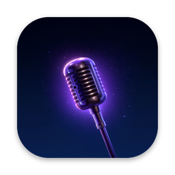
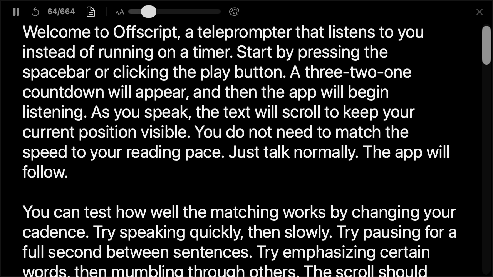

<h1>Offscript</h1>

A floating Mac teleprompter that follows your voice. 
It doesn't lose your place when you skip ahead, pause or ad-lib.

<strong>Version 0.3.0</strong> · macOS 14+ · Apple Silicon & Intel

  
  
  

<a href="https://github.com/madebysan/offscript/releases/latest">Download Offscript</a>

Offscript keeps track of where you are while you talk. Skip a paragraph, stop to ad-lib or rephrase a line, and it finds you again within a few words. Text in [brackets], like [pause] or [show the demo], stays on screen as a note and is never waited for. It runs on macOS 14 Sonoma or later, in a small window near the camera, for tutorials, talking-head videos and product walkthroughs.

- It scrolls to the line you're on, at your pace, and holds still while you're off script.
- It reopens your last script, with the five most recent a click away.
- The window stays hidden from screen sharing and screenshots.

## How it works

Paste a script and press play. The first time, macOS asks for the microphone and then for speech recognition. If either is off, the window says which one and opens the right page of System Settings. After a countdown, Offscript matches what you say against the script and keeps your current line near the top. The window floats above full-screen apps and follows you across Spaces, and the app lives in the menu bar with no Dock icon. Shortcuts and details are in [docs/how-it-works.md](docs/how-it-works.md).

## Privacy

Offscript needs Microphone and Speech Recognition access, and Siri & Dictation turned on. Speech recognition runs on your Mac when macOS supports it, and otherwise uses Apple's speech servers. Your scripts are saved only on your Mac. The app's own network use is the [Sparkle](https://sparkle-project.org) update check.

## Install

Download Offscript from the [latest release](https://github.com/madebysan/offscript/releases/latest) and drag it to Applications. It needs macOS 14 or later. To build it, run `xcodegen generate` and open `Cue.xcodeproj`.

---

[MIT](LICENSE). Offscript uses [Sparkle](https://github.com/sparkle-project/Sparkle); its license is in [THIRD_PARTY_NOTICES.md](THIRD_PARTY_NOTICES.md).

Made by [santiagoalonso.com](https://santiagoalonso.com)
